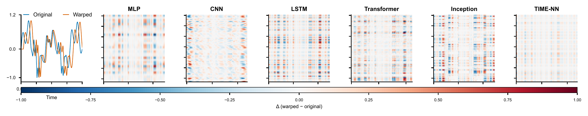

<div align="center">

# Time-NN: Temporally Stable Neural Networks for Robust Wi-Fi Sensing

[](https://www.python.org/)
[](https://pytorch.org/)
[](https://github.com/astral-sh/uv)

</div>

<div align="center">
Fei Shang &nbsp;&nbsp; Chenshu Wu<br>
School of Computing and Data Science, The University of Hong Kong
</div>

---

Official implementation of **Time-NN**, a lightweight, temporally stable
neural building block for time-series sensing.  Time-NN parameterises a wavelet
filter bank through differentiable analytic forms and combines nonlinear
demodulation, dynamic-range compression and invariant pooling with a
time–frequency feature-fusion module.  It can be used as a cascade, a
core-layer replacement, or a front-end plugin, and it comes with a Lipschitz
stability guarantee against nonlinear temporal distortion.

<p align="center">
  
</p>

<p align="center">
  <em>Feature-map difference between the original and a time-warped signal.
  Standard networks change strongly; Time-NN stays nearly invariant.</em>
</p>

---

## Installation

```bash
git clone https://github.com/zaoanhh/TimeNN.git
cd TimeNN
uv sync
uv run python scripts/check_install.py
```

The first sync downloads PyTorch and the scientific Python stack; later runs
reuse the uv cache.

## Reproducing the paper figures

All data-driven figures are regenerated from the result tables in
`data/results/`:

```bash
uv run python scripts/plots/plot_all.py
```

Individual figures:

```bash
uv run python scripts/plots/plot_motivation.py
uv run python scripts/plots/visualize_stability.py
uv run python scripts/plots/plot_feature_inversion.py
uv run python scripts/plots/plot_stability_drop.py
uv run python scripts/plots/plot_augmentation.py
```

Figures are written to `figures/`.  The two schematic figures (Fig. 1 and the
architecture drawings) are not generated by code.

## Training

Download a benchmark and point the matching YAML file to your local copy:

```yaml
# configs/lms_cnn_capture24/dataset/capture24.yaml
datadir: "/path/to/capture24/prepared_data/"
```

Supported datasets: `capture24`, `speechcommands`, `timit`, `medley`, `widar`,
`xrf55_wifi`, `xrf55_rfid`.

Train and evaluate:

```bash
uv run python scripts/train.py \
  --dataset capture24 \
  --model lms_cnn \
  --device cuda:0 \
  --output-path runs/with_tau.csv
```

The packaged example configuration is:

```
configs/lms_cnn_capture24/
├── config.yaml                 # Hydra entry point
├── dataset/capture24.yaml
├── model/lms_cnn_capture24.yaml
├── train/default.yaml
└── experiment/
    ├── _base.yaml
    └── lms_cnn_capture24.yaml
```

Add another `dataset/*.yaml`, `model/*.yaml` and `experiment/*.yaml` following
the same pattern to train a different combination.  The training loop uses the
paper's loss:

```
L_total = L_cross_entropy + 0.1 * L_coverage
```

## Model zoo

| Name | Class | Role |
| --- | --- | --- |
| `lmsnet` | `LMSNet` | Time-NN cascade |
| `lms_cnn` | `LMSCNN` | TN-CNN |
| `lms_resnet` | `LMSResNet` | TN-ResNet |
| `lms_tproj` | `LMSTProjTransformer` | Transformer with Time-NN input projection |
| `lms_tenc1` | `LMSTEnc1Transformer` | Transformer with one Time-NN encoder layer |
| `simple_cnn` | `SimpleCNNClassifier` | CNN baseline |
| `resnet1d` | `ResNet` (1D) | ResNet baseline |
| `transformer` | `TimeSeriesTransformer` | Transformer baseline |

## Using the block

```python
import torch
from timenn.models import FilterConfig, LMSBlock

block = LMSBlock(
    c_in=3,
    filter_config=FilterConfig(
        filter_type="morlet",
        scale_type="linear",
        num_scales=16,
        f_min=0.005,
        f_max=0.49,
        kernel_length=512,
        use_joint_mixing=True,
        pool_type="learnable",
    ),
    intra_out_per_group=1,
    inter_out=16,
    blur_stride=4,
    blur_kernel_size=51,
    use_log=False,
)

high_freq, stable_features = block(torch.randn(8, 3, 1000))
```

`block.get_total_coverage_loss()` returns the Parseval-frame regulariser.

## Temporal distortion operator

```python
from timenn.transforms import apply_time_deformation

x_warped = apply_time_deformation(
    x,
    warp_strength=0.2,
    num_knots=6,
    shift_ratio=0.05,
)
```

`TimeWarpTransform` is the `nn.Module` wrapper used by the training script.

## Project structure

```
Time-NN/
├── src/timenn/
│   ├── models/          # Time-NN block and all baselines
│   ├── data/            # dataset readers
│   ├── transforms/      # time warping and augmentation
│   └── plotting.py
├── scripts/
│   ├── train.py
│   ├── check_install.py
│   ├── plots/           # one script per paper figure
│   └── experiments/     # motivation-study driver
├── configs/lms_cnn_capture24/
├── data/results/        # result tables and waveforms
├── figures/
└── pyproject.toml
```

## Citation

```bibtex
@article{shang2026timenn,
  title   = {Temporally Stable Neural Networks for Robust Wi-Fi Sensing},
  author  = {Shang, Fei and Wu, Chenshu},
  journal = {Under review},
  year    = {2026}
}
```
